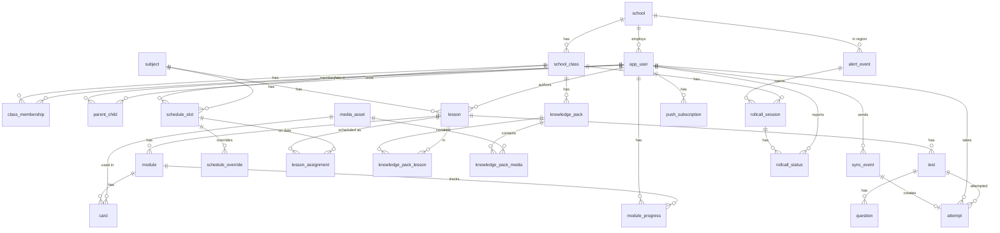

# ShelterED — чернетка схеми БД (B2)

Статус: **чернетка для обговорення**, 19.10.2026, бекенд (Стас). За нею пишуться SQLAlchemy-моделі й міграції в епіку B2. Джерело — план бекенду, підзадачі B2.1–B2.6.

Місця, де потрібне рішення команди, позначені **❓** і зібрані в кінці документа.

## Загальні правила

- **Ідентифікатори** — `uuid`. Для подій, спроб, прогресу й статусів переклички id створює клієнт ще офлайн (принцип 2 offline-first); сервер приймає його як є. ❓1
- **Час** — завжди `timestamptz` в UTC. Час розкладу (`time` без дати) — у поясі школи (`Europe/Kyiv`).
- Дві мітки часу для всього, що приходить з пристрою: `occurred_at` / `*_at_client` (годинник пристрою) і `received_at` (годинник сервера). Різниця між ними — основа перевірки часу (B9.4).
- **Переліки** (статуси, ролі, типи) — `text` + `CHECK (... IN (...))`, а не PostgreSQL `ENUM`: нове значення додається простою міграцією, яка відкочується.
- Імена обмежень задає naming convention у `app/models/base.py` (`pk_*`, `fk_*`, `uq_*`, `ix_*`, `ck_*`).
- `created_at` / `updated_at` (`timestamptz`, default `now()`) — у всіх таблицях, де дані редагуються; нижче не повторюються.
- Імена таблиць в однині. `user` і `class` — зарезервовані слова, тому `app_user` і `school_class`.
- Мінімум персональних даних про дітей (B15.1): жодних email, телефонів, дат народження учнів.

## ER-діаграма

---

## B2.1 Організаційна структура

### `school`
| Поле | Тип | Примітка |
|---|---|---|
| id | uuid PK | |
| name | text NOT NULL | |
| region_code | text NOT NULL | регіон для API тривог; формат залежить від обраного API ❓9 |
| timezone | text NOT NULL default `'Europe/Kyiv'` | для логіки розкладу |

Індекс: `ix_school_region_code` — B7.2 шукає всі школи регіону при тривозі.

### `school_class`
| Поле | Тип | Примітка |
|---|---|---|
| id | uuid PK | |
| school_id | uuid FK → school ON DELETE CASCADE | |
| name | text NOT NULL | «7-А» |
| grade | smallint CHECK 1..11 | |
| academic_year | text NOT NULL | «2026/2027» |
| join_code | text UNIQUE NOT NULL | код класу для входу учнів (B3.3, B5.1) |
| join_code_expires_at | timestamptz NULL | щоб старий код можна було відкликати |

UNIQUE (`school_id`, `academic_year`, `name`).

### `app_user`
| Поле | Тип | Примітка |
|---|---|---|
| id | uuid PK | |
| role | text CHECK IN (`student`, `teacher`, `parent`, `admin`) | одна роль на акаунт ❓3; роль психолога — відкрите питання плану |
| display_name | text NOT NULL, ≤ 50 | для учня — лише ім'я, яке вводить сам ❓2 |
| school_id | uuid FK → school NULL | NULL для батьків |
| email | citext UNIQUE NULL | лише вчитель / батьки / адміністрація; в учня завжди NULL |
| password_hash | text NULL | NULL для учня (вхід за кодом класу) |
| is_active | boolean default true | |
| last_seen_at | timestamptz NULL | |

CHECK: `role <> 'student' OR (email IS NULL AND password_hash IS NULL)`.

### `class_membership`
| Поле | Тип | Примітка |
|---|---|---|
| class_id | uuid FK → school_class ON DELETE CASCADE | PK (class_id, user_id) |
| user_id | uuid FK → app_user ON DELETE CASCADE | |
| member_role | text CHECK IN (`student`, `teacher`) | вчитель може вести кілька класів |
| joined_at | timestamptz default now() | |

Індекс: `ix_class_membership_user_id` — «мої класи» для вчителя, «мій клас» для учня; на ньому тримаються перевірки доступу (B3.4).

### `parent_child`
| Поле | Тип | Примітка |
|---|---|---|
| parent_id | uuid FK → app_user ON DELETE CASCADE | PK (parent_id, child_id) |
| child_id | uuid FK → app_user ON DELETE CASCADE | |
| linked_at | timestamptz default now() | |

Індекс: `ix_parent_child_child_id`. Одноразові коди прив'язки — таблиця в B3.3, не тут.

---

## B2.2 Навчальний контент

### `subject`
| Поле | Тип | Примітка |
|---|---|---|
| id | uuid PK | |
| school_id | uuid FK → school NULL | NULL = загальний довідник ❓10 |
| name | text NOT NULL | «Математика» |

### `lesson`
| Поле | Тип | Примітка |
|---|---|---|
| id | uuid PK | |
| subject_id | uuid FK → subject | |
| author_id | uuid FK → app_user | вчитель |
| title | text NOT NULL | |
| shelter_part | text NOT NULL | укриттєва частина перевернутого уроку: опис / інструкція |
| main_part | text NOT NULL | основна частина |
| status | text CHECK IN (`draft`, `published`) default `draft` | |
| version | integer NOT NULL default 1 | +1 при кожній зміні опублікованого уроку; пакет пам'ятає версію (B6.4) |
| published_at | timestamptz NULL | |
| grade | smallint NULL | для фільтрів |

Урок не прив'язаний до класу напряму: один урок можна провести в кількох класах через розклад ❓4.

### `module`
Мікро-модуль 3–5 хв.
| Поле | Тип | Примітка |
|---|---|---|
| id | uuid PK | |
| lesson_id | uuid FK → lesson ON DELETE CASCADE | |
| part | text CHECK IN (`shelter`, `main`) | до якої частини уроку належить |
| position | smallint NOT NULL | порядок |
| title | text NOT NULL | |
| duration_min | smallint CHECK 1..10 | орієнтир 3–5 |

UNIQUE (`lesson_id`, `part`, `position`).

### `card`
| Поле | Тип | Примітка |
|---|---|---|
| id | uuid PK | |
| module_id | uuid FK → module ON DELETE CASCADE | |
| position | smallint NOT NULL | UNIQUE (module_id, position) |
| kind | text CHECK IN (`text`, `image`, `video`) | |
| body | jsonb NOT NULL | текст / розмітка картки |
| media_asset_id | uuid FK → media_asset NULL | для image / video |

### `test`
| Поле | Тип | Примітка |
|---|---|---|
| id | uuid PK | |
| lesson_id | uuid FK → lesson ON DELETE CASCADE | |
| title | text NOT NULL | |
| window_enabled | boolean default false | тест із вікном (B11.1) |
| window_hours | smallint NULL CHECK IN (24, 48, 72) | обов'язкове, якщо `window_enabled` |

### `question`
| Поле | Тип | Примітка |
|---|---|---|
| id | uuid PK | |
| test_id | uuid FK → test ON DELETE CASCADE | |
| position | smallint NOT NULL | UNIQUE (test_id, position) |
| kind | text CHECK IN (`single`, `multiple`) | |
| prompt | text NOT NULL | |
| options | jsonb NOT NULL | `[{"id": "a", "text": "..."}]` |
| answer_key | jsonb NOT NULL | правильні `id`; чи йде в пакет — відкрите питання плану ❓5 |
| points | smallint default 1 | |

### `media_asset`
| Поле | Тип | Примітка |
|---|---|---|
| id | uuid PK | |
| kind | text CHECK IN (`video`, `image`, `subtitles`) | |
| storage_key | text UNIQUE NOT NULL | шлях в об'єктному сховищі або томі (відкрите питання плану) |
| mime_type | text NOT NULL | |
| size_bytes | bigint NOT NULL | для лімітів пакета (B6.5) |
| sha256 | text NOT NULL | кешування й дедуплікація |
| duration_s | integer NULL | для відео |
| subtitles_id | uuid FK → media_asset NULL | VTT до відео; публікація відео без субтитрів заборонена (B5.3) |
| uploaded_by | uuid FK → app_user | |

---

## B2.3 Розклад

### `schedule_slot`
Постійний тижневий слот.
| Поле | Тип | Примітка |
|---|---|---|
| id | uuid PK | |
| class_id | uuid FK → school_class ON DELETE CASCADE | |
| subject_id | uuid FK → subject | |
| weekday | smallint CHECK 1..7 | ISO: 1 = понеділок |
| starts_at | time NOT NULL | місцевий час школи |
| ends_at | time NOT NULL | CHECK ends_at > starts_at |
| valid_from | date NOT NULL | межі семестру |
| valid_to | date NULL | |

Індекс: (`class_id`, `weekday`) — «який урок зараз» (B5.2).

### `schedule_override`
Перевизначення на конкретну дату.
| Поле | Тип | Примітка |
|---|---|---|
| id | uuid PK | |
| class_id | uuid FK → school_class ON DELETE CASCADE | |
| date | date NOT NULL | |
| slot_id | uuid FK → schedule_slot NULL | NULL для додаткового уроку |
| kind | text CHECK IN (`cancel`, `replace`, `extra`) | |
| subject_id | uuid FK → subject NULL | для replace / extra |
| starts_at, ends_at | time NULL | для replace / extra |

### `lesson_assignment`
Який урок іде в слоті в конкретну дату (B5.3 «прив'язка уроку до слоту»). У плані урок прив'язаний до слоту; оскільки урок щотижня різний, прив'язка робиться на дату ❓4.
| Поле | Тип | Примітка |
|---|---|---|
| slot_id | uuid FK → schedule_slot ON DELETE CASCADE | PK (slot_id, date) |
| date | date | |
| lesson_id | uuid FK → lesson | |

---

## B2.4 Пакети знань «Рюкзак»

### `knowledge_pack`
| Поле | Тип | Примітка |
|---|---|---|
| id | uuid PK | |
| class_id | uuid FK → school_class ON DELETE CASCADE | пакет = клас + дата |
| pack_date | date NOT NULL | |
| version | integer NOT NULL | UNIQUE (class_id, pack_date, version); актуальна — найбільша |
| content_hash | text NOT NULL | sha256 вмісту; він же ETag (B6.3) |
| size_bytes | bigint NOT NULL | фактичний розмір (B6.5) |
| built_at | timestamptz NOT NULL | |

### `knowledge_pack_lesson`
| Поле | Тип | Примітка |
|---|---|---|
| pack_id | uuid FK → knowledge_pack ON DELETE CASCADE | PK (pack_id, lesson_id) |
| lesson_id | uuid FK → lesson | |
| lesson_version | integer NOT NULL | версія уроку на момент збірки |

### `knowledge_pack_media`
| Поле | Тип | Примітка |
|---|---|---|
| pack_id | uuid FK → knowledge_pack ON DELETE CASCADE | PK (pack_id, media_asset_id) |
| media_asset_id | uuid FK → media_asset | |

---

## B2.5 Результати й події

### `sync_event`
Журнал усіх подій з пристроїв — основа ідемпотентності (B9.2).
| Поле | Тип | Примітка |
|---|---|---|
| client_event_id | uuid PK | створює клієнт; `INSERT ... ON CONFLICT DO NOTHING` |
| type | text CHECK IN (`module_progress`, `test_attempt`, `rollcall_status`, `survey_answer`) | |
| user_id | uuid FK → app_user | автор події (учень) |
| device_id | uuid NOT NULL | id пристрою, який створює клієнт ❓7 |
| occurred_at | timestamptz NOT NULL | годинник пристрою |
| received_at | timestamptz default now() | годинник сервера |
| clock_skew_ms | integer NULL | зсув годинника пристрою з пакета (B9.4) |
| is_suspicious | boolean default false | час у майбутньому / великий зсув — позначка, не блокування |
| source | text CHECK IN (`online`, `qr`) default `online` | QR — B10 |
| relayed_by | uuid FK → app_user NULL | вчитель, який передав QR-події (B10.3) |
| payload | jsonb NOT NULL | |
| status | text CHECK IN (`accepted`, `rejected`) | |
| reject_reason | text NULL | |

Індекс: (`user_id`, `received_at`). Курсор для `GET /sync/changes` проєктується в B9.5.

### `attempt`
Спроба тесту.
| Поле | Тип | Примітка |
|---|---|---|
| id | uuid PK | |
| client_event_id | uuid UNIQUE FK → sync_event | одна подія — одна спроба |
| student_id | uuid FK → app_user | |
| test_id | uuid FK → test | |
| answers | jsonb NOT NULL | `{"<question_id>": ["a"]}` |
| completed_at_client | timestamptz NOT NULL | для вікна тесту рахується саме він (B11.3) |
| received_at | timestamptz default now() | |
| score | numeric(5,2) NULL | рахує сервер за `answer_key` (B11.4) |
| credit_status | text CHECK IN (`credited`, `not_credited_late`, `not_credited_repeat`) | |
| is_suspicious | boolean default false | |

Частковий UNIQUE (`student_id`, `test_id`) WHERE `credit_status = 'credited'` — у БД неможливо зарахувати дві спроби (B9.3: перша завершена).

### `module_progress`
| Поле | Тип | Примітка |
|---|---|---|
| student_id | uuid FK → app_user ON DELETE CASCADE | PK (student_id, module_id) |
| module_id | uuid FK → module ON DELETE CASCADE | |
| progress_pct | smallint CHECK 0..100 | оновлення через `GREATEST` — беремо максимум (B9.3) |
| completed_at_client | timestamptz NULL | |
| last_event_id | uuid FK → sync_event | остання подія, яка змінила рядок |

---

## B2.6 Безпека

### `alert_event`
| Поле | Тип | Примітка |
|---|---|---|
| id | uuid PK | |
| region_code | text NOT NULL | |
| school_id | uuid FK → school NULL | запис для кожної школи регіону (B7.2) |
| class_id | uuid FK → school_class NULL | ручна тривога для класу (B7.3) |
| source | text CHECK IN (`api`, `manual`) | |
| external_id | text NULL | id події від AI-сервісу; UNIQUE (source, external_id, school_id) — повтори ігноруються (B7.1) |
| is_drill | boolean default false | тренувальна |
| started_at | timestamptz NOT NULL | |
| ended_at | timestamptz NULL | відбій |
| created_by | uuid FK → app_user NULL | вчитель для ручної |

Індекс: (`school_id`, `started_at`) — журнал тривог школи (B14.4). Частковий індекс для `GET /alerts/active`: WHERE `ended_at IS NULL`.

### `rollcall_session`
| Поле | Тип | Примітка |
|---|---|---|
| id | uuid PK | |
| class_id | uuid FK → school_class ON DELETE CASCADE | |
| alert_event_id | uuid FK → alert_event NULL | NULL, якщо відкрив вчитель вручну |
| opened_by | uuid FK → app_user NULL | NULL при автовідкритті |
| is_drill | boolean default false | |
| opened_at | timestamptz NOT NULL | |
| closed_at | timestamptz NULL | закривається з відбоєм (B12.1) |

Частковий UNIQUE (`class_id`) WHERE `closed_at IS NULL` — не більше однієї відкритої переклички на клас.

### `rollcall_status`
| Поле | Тип | Примітка |
|---|---|---|
| session_id | uuid FK → rollcall_session ON DELETE CASCADE | PK (session_id, student_id) |
| student_id | uuid FK → app_user ON DELETE CASCADE | |
| status | text CHECK IN (`safe`, `in_shelter`) | «Немає відповіді» = рядка немає ❓6 |
| occurred_at | timestamptz NOT NULL | годинник пристрою; перемагає найпізніший (B9.3) |
| received_at | timestamptz NOT NULL | видно, чи статус міг застаріти (B12.3) |
| last_event_id | uuid FK → sync_event | |

Оновлення: `INSERT ... ON CONFLICT (session_id, student_id) DO UPDATE ... WHERE excluded.occurred_at > rollcall_status.occurred_at`.

### `push_subscription`
| Поле | Тип | Примітка |
|---|---|---|
| id | uuid PK | |
| user_id | uuid FK → app_user ON DELETE CASCADE | кілька пристроїв на користувача (B8.2) |
| endpoint | text UNIQUE NOT NULL | URL push-сервісу браузера |
| p256dh | text NOT NULL | ключі підписки |
| auth | text NOT NULL | |
| last_success_at | timestamptz NULL | метрики (B8.5) |
| failed_at | timestamptz NULL | 404/410 → видалити (B8.4) |

---

## Поза B2 (з'явиться у своїх епіках)

- Одноразові коди прив'язки батьків, refresh-токени — B3.
- Ключ пристрою для підпису QR — B10.2 (можливо, разом із таблицею `device` ❓7).
- Відповіді опитування «як ти зараз?» і журнал доступу до них — B13.4 / B15.4, окремо від решти даних.
- Агрегати (прогрес класу, мапа знань) — B9.6 / B14.

## ❓ Рішення, які потрібні

1. **UUID v7 чи v4.** План вимагає v7 (сортується за часом → швидші індекси, зручний порядок подій). Фронтенд зараз генерує v4 (`frontend/src/shared/lib/uuid.ts`). У Python 3.13 немає `uuid7()` — на сервері знадобиться бібліотека. Сервер у будь-якому разі приймає будь-який валідний UUID. Погодити з Максимом.
2. **Дані учня.** Пропозиція: лише `display_name` (ім'я, як учень назвався при вході за кодом класу), без прізвища. Чи потрібне вчителю прізвище для журналу?
3. **Одна роль на акаунт.** Вчитель, який є й батьком, матиме два акаунти. Альтернатива — таблиця ролей (складніші перевірки доступу).
4. **Урок ↔ клас.** Урок не належить класу, а призначається на слот у конкретну дату (`lesson_assignment`). Альтернатива — `lesson.class_id` (простіше, але урок не перевикористати в паралельному класі).
5. **Ключ відповідей у пакеті** — відкрите питання плану; на схему не впливає (ключ зберігається в `question` у будь-якому разі), лише на збірку пакета.
6. **«Немає відповіді» в перекличці** — не зберігаємо рядок (рахується як відсутність статусу) чи створюємо рядки `no_response` для всіх учнів при відкритті сесії.
7. **Пристрої.** Поки `device_id` — просто uuid без окремої таблиці. Таблиця `device` знадобиться для ключа QR (B10.2) і, можливо, для push.
8. **Видалення даних учня (B15.5).** Повне видалення (`ON DELETE CASCADE`, як у чернетці) чи анонімізація зі збереженням агрегатів класу.
9. **Формат `region_code`** — залежить від того, яке API тривог обере Роман.
10. **Предмети** — спільний довідник чи свої для кожної школи.
