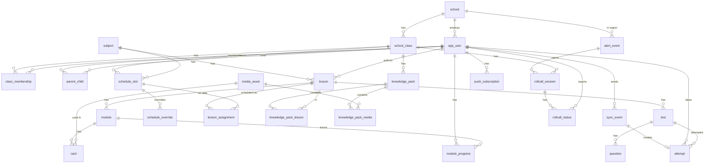

# ShelterED — чернетка схеми БД (B2)

Статус: **чернетка для обговорення**, 19.10.2026, бекенд (Стас). За нею пишуться SQLAlchemy-моделі й міграції в епіку B2. Джерело — план бекенду, підзадачі B2.1–B2.6.

Місця, де потрібне рішення команди, позначені **❓** і зібрані в кінці документа.

## Загальні правила

- **Ідентифікатори** — `uuid`. Для подій, спроб, прогресу й статусів переклички id створює клієнт ще офлайн (принцип 2 offline-first); сервер приймає його як є. ❓1
- **Час** — завжди `timestamptz` в UTC. Час розкладу (`time` без дати) — у поясі школи (`Europe/Kyiv`).
- Дві мітки часу для всього, що приходить з пристрою: `occurred_at` / `*_at_client` (годинник пристрою) і `received_at` (годинник сервера). Різниця між ними — основа перевірки часу (B9.4).
- **Переліки** (статуси, ролі, типи) — `text` + `CHECK (... IN (...))`, а не PostgreSQL `ENUM`: нове значення додається простою міграцією, яка відкочується.
- Імена обмежень задає naming convention у `app/models/base.py` (`pk_*`, `fk_*`, `uq_*`, `ix_*`, `ck_*`).
- `created_at` / `updated_at` (`timestamptz`, default `now()`) — у всіх таблицях, де дані редагуються; нижче не повторюються.
- Імена таблиць в однині. `user` і `class` — зарезервовані слова, тому `app_user` і `school_class`.
- Мінімум персональних даних про дітей (B15.1): жодних email, телефонів, дат народження учнів.

## ER-діаграма

---

## B2.1 Організаційна структура

### `school`
| Поле | Тип | Примітка |
|---|---|---|
| id | uuid PK | |
| name | text NOT NULL | |
| region_code | text NOT NULL | регіон для API тривог; формат залежить від обраного API ❓9 |
| timezone | text NOT NULL default `'Europe/Kyiv'` | для логіки розкладу |

Індекс: `ix_school_region_code` — B7.2 шукає всі школи регіону при тривозі.

### `school_class`
| Поле | Тип | Примітка |
|---|---|---|
| id | uuid PK | |
| school_id | uuid FK → school ON DELETE CASCADE | |
| name | text NOT NULL | «7-А» |
| grade | smallint CHECK 1..11 | |
| academic_year | text NOT NULL | «2026/2027» |
| join_code | text UNIQUE NOT NULL | код класу для входу учнів (B3.3, B5.1); зберігається нормалізованим: лише `A-Z0-9` (`normalize_link_code`, CHECK `ck_school_class_join_code_format`), на вході нормалізується так само |
| join_code_expires_at | timestamptz NULL | щоб старий код можна було відкликати; обмежує лише створення нових учнів, наявні входять і після нього |

UNIQUE (`school_id`, `academic_year`, `name`).

### `app_user`
| Поле | Тип | Примітка |
|---|---|---|
| id | uuid PK | |
| role | text CHECK IN (`student`, `teacher`, `parent`, `admin`) | одна роль на акаунт ❓3; роль психолога — відкрите питання плану |
| display_name | text NOT NULL, ≤ 50 | ім'я; для учня — те, яке вводить сам ❓2 |
| last_name | text NULL, ≤ 50 | прізвище; у БД допускаємо NULL (вчитель / адміністрація можуть не вказувати), для учня його вимагає API ❓2 |
| school_id | uuid FK → school NULL | NULL для батьків |
| email | citext UNIQUE NULL | лише вчитель / батьки / адміністрація; в учня завжди NULL |
| password_hash | text NULL | NULL для учня (вхід за кодом класу) |
| pin_hash | text NULL | PIN учня (argon2); NULL після скидання вчителем. Лише для `student` |
| name_key | text NULL, індекс | нормалізовані імʼя+прізвище учня для пошуку в класі; у дорослих NULL |
| token_version | integer NOT NULL default 0 | епоха облікових даних: скидання PIN збільшує; access-токен несе `ver`, refresh-токен зберігає версію |
| is_active | boolean default true | |
| last_seen_at | timestamptz NULL | |

CHECK: `role <> 'student' OR (email IS NULL AND password_hash IS NULL)`; `role = 'student' OR pin_hash IS NULL`.

### `class_membership`
| Поле | Тип | Примітка |
|---|---|---|
| class_id | uuid FK → school_class ON DELETE CASCADE | PK (class_id, user_id) |
| user_id | uuid FK → app_user ON DELETE CASCADE | |
| member_role | text CHECK IN (`student`, `teacher`) | вчитель може вести кілька класів |
| joined_at | timestamptz default now() | |

Індекс: `ix_class_membership_user_id` — «мої класи» для вчителя, «мій клас» для учня; на ньому тримаються перевірки доступу (B3.4).

### `parent_child`
| Поле | Тип | Примітка |
|---|---|---|
| parent_id | uuid FK → app_user ON DELETE CASCADE | PK (parent_id, child_id) |
| child_id | uuid FK → app_user ON DELETE CASCADE | |
| linked_at | timestamptz default now() | |

Індекс: `ix_parent_child_child_id`. Одноразові коди прив'язки — таблиця `parent_link_code` (розділ «Авторизація» нижче).

---

## B2.2 Навчальний контент

### `subject`
| Поле | Тип | Примітка |
|---|---|---|
| id | uuid PK | |
| school_id | uuid FK → school NULL | NULL = загальний довідник ❓10 |
| name | text NOT NULL | «Математика» |

### `lesson`
| Поле | Тип | Примітка |
|---|---|---|
| id | uuid PK | |
| subject_id | uuid FK → subject | |
| author_id | uuid FK → app_user | вчитель |
| title | text NOT NULL | |
| shelter_part | text NOT NULL | укриттєва частина перевернутого уроку: опис / інструкція |
| main_part | text NOT NULL | основна частина |
| status | text CHECK IN (`draft`, `published`) default `draft` | |
| version | integer NOT NULL default 1 | +1 при кожній зміні опублікованого уроку; пакет пам'ятає версію (B6.4) |
| published_at | timestamptz NULL | |
| grade | smallint NULL | для фільтрів |

Урок не прив'язаний до класу напряму: один урок можна провести в кількох класах через розклад ❓4.

### `module`
Мікро-модуль 3–5 хв.
| Поле | Тип | Примітка |
|---|---|---|
| id | uuid PK | |
| lesson_id | uuid FK → lesson ON DELETE CASCADE | |
| part | text CHECK IN (`shelter`, `main`) | до якої частини уроку належить |
| position | smallint NOT NULL | порядок |
| title | text NOT NULL | |
| duration_min | smallint CHECK 1..10 | орієнтир 3–5 |

UNIQUE (`lesson_id`, `part`, `position`).

### `card`
| Поле | Тип | Примітка |
|---|---|---|
| id | uuid PK | |
| module_id | uuid FK → module ON DELETE CASCADE | |
| position | smallint NOT NULL | UNIQUE (module_id, position) |
| kind | text CHECK IN (`text`, `image`, `video`) | |
| body | jsonb NOT NULL | текст / розмітка картки |
| media_asset_id | uuid FK → media_asset NULL | для image / video |

### `test`
| Поле | Тип | Примітка |
|---|---|---|
| id | uuid PK | |
| lesson_id | uuid FK → lesson ON DELETE CASCADE | |
| title | text NOT NULL | |
| window_enabled | boolean default false | тест із вікном (B11.1) |
| window_hours | smallint NULL CHECK IN (24, 48, 72) | обов'язкове, якщо `window_enabled` |

### `question`
| Поле | Тип | Примітка |
|---|---|---|
| id | uuid PK | |
| test_id | uuid FK → test ON DELETE CASCADE | |
| position | smallint NOT NULL | UNIQUE (test_id, position) |
| kind | text CHECK IN (`single`, `multiple`) | |
| prompt | text NOT NULL | |
| options | jsonb NOT NULL | `[{"id": "a", "text": "..."}]` |
| answer_key | jsonb NOT NULL | правильні `id`; чи йде в пакет — відкрите питання плану ❓5 |
| points | smallint default 1 | |

### `media_asset`
| Поле | Тип | Примітка |
|---|---|---|
| id | uuid PK | |
| kind | text CHECK IN (`video`, `image`, `subtitles`) | |
| storage_key | text UNIQUE NOT NULL | шлях в об'єктному сховищі або томі (відкрите питання плану) |
| mime_type | text NOT NULL | |
| size_bytes | bigint NOT NULL | для лімітів пакета (B6.5) |
| sha256 | text NOT NULL | кешування й дедуплікація |
| duration_s | integer NULL | для відео |
| subtitles_id | uuid FK → media_asset NULL | VTT до відео; публікація відео без субтитрів заборонена (B5.3) |
| uploaded_by | uuid FK → app_user | |

---

## B2.3 Розклад

### `schedule_slot`
Постійний тижневий слот.
| Поле | Тип | Примітка |
|---|---|---|
| id | uuid PK | |
| class_id | uuid FK → school_class ON DELETE CASCADE | |
| subject_id | uuid FK → subject | |
| weekday | smallint CHECK 1..7 | ISO: 1 = понеділок |
| starts_at | time NOT NULL | місцевий час школи |
| ends_at | time NOT NULL | CHECK ends_at > starts_at |
| valid_from | date NOT NULL | межі семестру |
| valid_to | date NULL | |

Індекс: (`class_id`, `weekday`) — «який урок зараз» (B5.2).

### `schedule_override`
Перевизначення на конкретну дату.
| Поле | Тип | Примітка |
|---|---|---|
| id | uuid PK | |
| class_id | uuid FK → school_class ON DELETE CASCADE | |
| date | date NOT NULL | |
| slot_id | uuid FK → schedule_slot NULL | NULL для додаткового уроку |
| kind | text CHECK IN (`cancel`, `replace`, `extra`) | |
| subject_id | uuid FK → subject NULL | для replace / extra |
| starts_at, ends_at | time NULL | для replace / extra |

### `lesson_assignment`
Який урок іде в слоті в конкретну дату (B5.3 «прив'язка уроку до слоту»). У плані урок прив'язаний до слоту; оскільки урок щотижня різний, прив'язка робиться на дату ❓4.
| Поле | Тип | Примітка |
|---|---|---|
| slot_id | uuid FK → schedule_slot ON DELETE CASCADE | PK (slot_id, date) |
| date | date | |
| lesson_id | uuid FK → lesson | |

---

## B2.4 Пакети знань «Рюкзак»

### `knowledge_pack`
| Поле | Тип | Примітка |
|---|---|---|
| id | uuid PK | |
| class_id | uuid FK → school_class ON DELETE CASCADE | пакет = клас + дата |
| pack_date | date NOT NULL | |
| version | integer NOT NULL | UNIQUE (class_id, pack_date, version); актуальна — найбільша |
| content_hash | text NOT NULL | sha256 вмісту; він же ETag (B6.3) |
| size_bytes | bigint NOT NULL | фактичний розмір (B6.5) |
| built_at | timestamptz NOT NULL | |

### `knowledge_pack_lesson`
| Поле | Тип | Примітка |
|---|---|---|
| pack_id | uuid FK → knowledge_pack ON DELETE CASCADE | PK (pack_id, lesson_id) |
| lesson_id | uuid FK → lesson | |
| lesson_version | integer NOT NULL | версія уроку на момент збірки |

### `knowledge_pack_media`
| Поле | Тип | Примітка |
|---|---|---|
| pack_id | uuid FK → knowledge_pack ON DELETE CASCADE | PK (pack_id, media_asset_id) |
| media_asset_id | uuid FK → media_asset | |

---

## B2.5 Результати й події

### `sync_event`
Журнал усіх подій з пристроїв — основа ідемпотентності (B9.2).
| Поле | Тип | Примітка |
|---|---|---|
| client_event_id | uuid PK | створює клієнт; `INSERT ... ON CONFLICT DO NOTHING` |
| type | text CHECK IN (`module_progress`, `test_attempt`, `rollcall_status`, `survey_answer`) | |
| user_id | uuid FK → app_user | автор події (учень) |
| device_id | uuid NOT NULL | id пристрою, який створює клієнт ❓7 |
| occurred_at | timestamptz NOT NULL | годинник пристрою |
| received_at | timestamptz default now() | годинник сервера |
| clock_skew_ms | bigint NULL | зсув годинника пристрою з пакета (B9.4) |
| is_suspicious | boolean default false | час у майбутньому / великий зсув — позначка, не блокування |
| source | text CHECK IN (`online`, `qr`) default `online` | QR — B10 |
| relayed_by | uuid FK → app_user NULL | вчитель, який передав QR-події (B10.3) |
| payload | jsonb NOT NULL | |
| status | text CHECK IN (`accepted`, `rejected`) | |
| reject_reason | text NULL | |

Індекс: (`user_id`, `received_at`). Курсор для `GET /sync/changes` проєктується в B9.5.

### `attempt`
Спроба тесту.
| Поле | Тип | Примітка |
|---|---|---|
| id | uuid PK | |
| client_event_id | uuid UNIQUE FK → sync_event | одна подія — одна спроба |
| student_id | uuid FK → app_user | |
| test_id | uuid FK → test | |
| answers | jsonb NOT NULL | `{"<question_id>": ["a"]}` |
| completed_at_client | timestamptz NOT NULL | для вікна тесту рахується саме він (B11.3) |
| received_at | timestamptz default now() | |
| score | numeric(5,2) NULL | рахує сервер за `answer_key` (B11.4) |
| credit_status | text CHECK IN (`credited`, `not_credited_late`, `not_credited_repeat`) | |
| is_suspicious | boolean default false | |

Частковий UNIQUE (`student_id`, `test_id`) WHERE `credit_status = 'credited'` — у БД неможливо зарахувати дві спроби (B9.3: перша завершена).

### `module_progress`
| Поле | Тип | Примітка |
|---|---|---|
| student_id | uuid FK → app_user ON DELETE CASCADE | PK (student_id, module_id) |
| module_id | uuid FK → module ON DELETE CASCADE | |
| progress_pct | smallint CHECK 0..100 | оновлення через `GREATEST` — беремо максимум (B9.3) |
| completed_at_client | timestamptz NULL | |
| last_event_id | uuid FK → sync_event | остання подія, яка змінила рядок |

---

## B2.6 Безпека

### `alert_event`
| Поле | Тип | Примітка |
|---|---|---|
| id | uuid PK | |
| region_code | text NOT NULL | |
| school_id | uuid FK → school NULL | запис для кожної школи регіону (B7.2) |
| class_id | uuid FK → school_class NULL | ручна тривога для класу (B7.3) |
| source | text CHECK IN (`api`, `manual`) | |
| external_id | text NULL | id тривоги провайдера (бекенд опитує API сам, B7); унікальний індекс `uq_alert_event_source_region_external_school` (source, region_code, external_id, school_id) NULLS NOT DISTINCT WHERE external_id IS NOT NULL — повтори ігноруються, NULL у school_id не обходить унікальність; відбій — `ended_at` того самого рядка, а не окрема подія; ручні тривоги без external_id можуть повторюватися (B7.1) |
| is_drill | boolean default false | тренувальна |
| started_at | timestamptz NOT NULL | |
| ended_at | timestamptz NULL | відбій |
| created_by | uuid FK → app_user NULL | вчитель для ручної |

Індекс: (`school_id`, `started_at`) — журнал тривог школи (B14.4). Частковий індекс для `GET /alerts/active`: WHERE `ended_at IS NULL`.

### `alert_source` (B7.6)
| Поле | Тип | Примітка |
|---|---|---|
| name | text PK | провайдер, напр. `alerts.in.ua` |
| last_success_at | timestamptz NULL | останнє успішне опитування; давніше `ALERTS_SOURCE_STALE_S` → `source_available = false` |
| last_attempt_at | timestamptz NULL | |
| last_error | text NULL | лише тип помилки (без тексту: там може бути URL із токеном) |

### `rollcall_session`
| Поле | Тип | Примітка |
|---|---|---|
| id | uuid PK | |
| class_id | uuid FK → school_class ON DELETE CASCADE | |
| alert_event_id | uuid FK → alert_event NULL | NULL, якщо відкрив вчитель вручну |
| opened_by | uuid FK → app_user NULL | NULL при автовідкритті |
| is_drill | boolean default false | |
| opened_at | timestamptz NOT NULL | |
| closed_at | timestamptz NULL | закривається з відбоєм (B12.1) |

Частковий UNIQUE (`class_id`) WHERE `closed_at IS NULL` — не більше однієї відкритої переклички на клас.

### `rollcall_status`
| Поле | Тип | Примітка |
|---|---|---|
| session_id | uuid FK → rollcall_session ON DELETE CASCADE | PK (session_id, student_id) |
| student_id | uuid FK → app_user ON DELETE CASCADE | |
| status | text CHECK IN (`safe`, `in_shelter`) | «Немає відповіді» = рядка немає ❓6 |
| occurred_at | timestamptz NOT NULL | годинник пристрою; перемагає найпізніший (B9.3) |
| received_at | timestamptz NOT NULL | видно, чи статус міг застаріти (B12.3) |
| last_event_id | uuid FK → sync_event | |

Оновлення: `INSERT ... ON CONFLICT (session_id, student_id) DO UPDATE ... WHERE excluded.occurred_at > rollcall_status.occurred_at`.

### `push_subscription`
| Поле | Тип | Примітка |
|---|---|---|
| id | uuid PK | |
| user_id | uuid FK → app_user ON DELETE CASCADE | кілька пристроїв на користувача (B8.2) |
| endpoint | text UNIQUE NOT NULL | URL push-сервісу браузера |
| p256dh | text NOT NULL | ключі підписки |
| auth | text NOT NULL | |
| last_success_at | timestamptz NULL | метрики (B8.5) |
| failed_at | timestamptz NULL | 404/410 → видалити (B8.4) |

---

## Авторизація (B3)

Токени й коди зберігаються лише як SHA-256 хеш.

### `refresh_token`
| Поле | Тип | Примітка |
|---|---|---|
| id | uuid PK | |
| user_id | uuid FK → app_user ON DELETE CASCADE | |
| family_id | uuid NOT NULL | спільний для всіх токенів одного входу; індекс `ix_refresh_token_family_id`; також `ix_refresh_token_user_id` |
| token_hash | text UNIQUE NOT NULL | |
| expires_at | timestamptz NOT NULL | 30 днів |
| rotated_at | timestamptz NULL | токен ротовано (звичайна заміна); дає право на повтор у межах вікна |
| revoked_at | timestamptz NULL | вихід, скидання PIN або відкликана родина; такий токен не працює ніколи |
| replaced_by_id | uuid FK → refresh_token NULL | найновіший токен, виданий замість цього (при повторі переставляється) |
| token_version | integer NOT NULL default 0 | `app_user.token_version` на момент видачі |
| created_at | timestamptz default now() | |
| user_agent | text NULL | без IP-адреси |

### `auth_code`
Код авторизації OAuth 2.0 PKCE.
| Поле | Тип | Примітка |
|---|---|---|
| id | uuid PK | |
| code_hash | text UNIQUE NOT NULL | |
| user_id | uuid FK → app_user ON DELETE CASCADE | |
| code_challenge | text NOT NULL | S256 |
| client_id | text NOT NULL | |
| redirect_uri | text NULL | |
| expires_at | timestamptz NOT NULL | 60 с |
| used_at | timestamptz NULL | одноразовий |

### `parent_link_code`
| Поле | Тип | Примітка |
|---|---|---|
| id | uuid PK | |
| code_hash | text UNIQUE NOT NULL | |
| child_id | uuid FK → app_user ON DELETE CASCADE | |
| created_by | uuid FK → app_user ON DELETE SET NULL | вчитель або адмін |
| expires_at | timestamptz NOT NULL | 7 днів |
| used_at | timestamptz NULL | одноразовий |
| used_by | uuid FK → app_user ON DELETE SET NULL | батьки, які ввели код |

---

## Поза B2 (з'явиться у своїх епіках)

- Ключ пристрою для підпису QR — B10.2 (можливо, разом із таблицею `device` ❓7).
- Відповіді опитування «як ти зараз?» і журнал доступу до них — B13.4 / B15.4, окремо від решти даних.
- Агрегати (прогрес класу, мапа знань) — B9.6 / B14.

## Рішення (раніше ❓)

Усі питання закрито 01.11.2026.

1. **UUID** — ✅ сервер приймає будь-який валідний клієнтський UUID як є. Для рядків, які створює сервер, `uuid4`; v7 — коли погодимо бібліотеку.
2. **Дані учня** — ✅ ім'я та прізвище учня (`display_name`, `last_name`), без email і телефону.
3. **Одна роль на акаунт** — ✅ `app_user.role` з `CHECK`; вчитель-батько матиме два акаунти.
4. **Урок ↔ клас** — ✅ лише через розклад на дату (`lesson_assignment`), без `lesson.class_id`.
5. **Ключ відповідей** — ✅ лишається в `question`; чи йде в пакет — питання збірки пакета, не схеми.
6. **«Немає відповіді» в перекличці** — ✅ рядка немає, статусу `no_response` не існує.
7. **Пристрої** — ✅ `device_id` — звичайний uuid, таблиці `device` поки немає.
8. **Видалення даних учня** — ✅ повне видалення, `ON DELETE CASCADE` від користувача до його даних.
9. **`region_code`** — ✅ звичайний `text`.
10. **Предмети** — ✅ `subject.school_id = NULL` означає загальний довідник.

> `alert_event`: унікальний індекс `uq_alert_event_source_region_external_school` частковий, тому ідемпотентна вставка має бути `on_conflict_do_nothing(index_elements=[...], index_where=text("external_id IS NOT NULL"))`, а не `constraint=`.

## Рішення B5 (05.11.2026)

Міграція `b8f50e29ecc5`: UNIQUE (`schedule_override.slot_id`, `date`) — не більше одного перевизначення слота на дату (extra без слота не обмежені); індекси `ix_schedule_override_class_id_date`, `ix_lesson_assignment_lesson_id`, `ix_lesson_author_id`. Нових полів про дітей немає.

- **Клієнтські id й ідемпотентність.** Створення (`POST` класу, предмета, слота, перевизначення, уроку, модуля, картки, тесту, питання; `PUT /media/{id}`) приймає `id` від клієнта: `INSERT ... ON CONFLICT (id) DO NOTHING`. Повтор із тими самими даними → 200 і наявний ресурс, той самий id з іншими даними чи іншим власником → 409 `ID_CONFLICT`. Інші записи ідемпотентні за природою (PATCH, PUT прив'язок, DELETE відсутнього → 204).
- **Класи.** Пише лише адміністрація своєї школи; `join_code` генерує сервер (`new_link_code`), перегенерація одразу робить старий код недійсним для нових учнів. Видалити можна лише клас без учнів (409 `CLASS_NOT_EMPTY`), бо CASCADE зніс би перекличку й пакети.
- **Розклад.** Слоти й перевизначення пише адміністрація; читають учні, вчителі класу й адміністрація. Видалення слота видаляє його перевизначення й прив'язки уроків (щоб завершити слот без втрати історії — `valid_to`). «Який урок зараз» — чисті функції `app/services/schedule.py` (`resolve_day`, `current_item`) у поясі `school.timezone`; межі уроку `[початок, кінець)`; неоднозначна година при переході на зимовий час — `fold=0`.
- **Уроки.** Пише лише автор (вчитель); адміністрація й інші вчителі школи читають, учні й батьки — ні (їм урок прийде в пакеті B6). **Опублікований урок незмінний** (409 `LESSON_PUBLISHED`): вчитель робить `unpublish` → правки → `publish`; повторна публікація збільшує `version`. Прив'язки в розкладі при цьому лишаються, пакети беруть лише опубліковані уроки. Видалити можна лише чернетку без прив'язок і результатів (409 `LESSON_IN_USE`).
- **Публікація** перевіряє все разом і повертає 422 `LESSON_NOT_PUBLISHABLE` зі списком у `details`: `shelter_part` не порожня; кожне відео має VTT-субтитри; урок ≤ `PACK_MAX_DAY_BYTES`; пакети днів, де урок уже стоїть, ≤ ліміту. Розмір = текст уроку (octet_length полів) + унікальні медіа карток із їхніми субтитрами.
- **Прив'язка уроку** (`lesson_assignment`): лише вчитель цього класу, лише опублікований урок своєї школи, лише в день слота й не в скасований слот. Пакет класу на дату (унікальні уроки всіх слотів дня) ≤ 50 МБ, інакше 422 `PACK_DAY_LIMIT_EXCEEDED`. Додаткові уроки (`extra`) без слота поки не мають прив'язки уроку.
- **Медіа.** `PUT /media/{id}?kind=` із сирим тілом (не multipart, без нових залежностей): потік пишеться в тимчасовий файл із перевіркою розміру на льоту, потім атомарно перейменовується. Тип перевіряється за `Content-Type` і сигнатурою; VTT — UTF-8. Ключ `<kind>/<id>-<random>.<ext>`, ім'я файла від клієнта не використовується. Ліміти: відео 30 МБ, зображення 2 МБ, VTT 200 КБ. Сховище — `LocalMediaStorage` (`MEDIA_ROOT`, URL `MEDIA_URL_PREFIX`) за інтерфейсом `MediaStorage` (`app/core/storage.py`) для заміни на S3. До картки можна прикріпити лише власний файл вчителя; відв'язати субтитри від відео опублікованого уроку не можна.

## Рішення B7 «Тривоги» (05.11.2026)

Міграція `39ee76b5434f`: ключ дедуплікації тривог `uq_alert_event_source_region_external_school` (source, region_code, external_id, school_id) замість (source, external_id, school_id); таблиця `alert_source`. Нових полів про дітей немає.

- **Провайдер.** alerts.in.ua (`GET https://api.alerts.in.ua/v1/alerts/active.json`, `Authorization: Bearer`), за інтерфейсом `AlertProvider` (`app/services/alert_provider.py`) — інше API підключається новим класом. Токен — `ALERTS_API_TOKEN` (порожній → опитування вимкнене), у логи не потрапляє; у `alert_source.last_error` — лише код (`timeout`, `http_429`, `invalid_response`).
- **`school.region_code`** = id області провайдера як текст (`location_uid`: «31» — м. Київ, «14» — Київська область). Беремо лише тривоги рівня області (`location_type = oblast`) будь-якого типу; тривоги району чи громади не вмикають тривогу для всієї області.
- **Опитування** — Celery beat `alerts.poll` (черга `default`, `ALERTS_POLL_INTERVAL_S` = 30 с). Стан-орієнтоване: активна тривога → рядок `alert_event` для кожної школи регіону (`ON CONFLICT DO NOTHING`); тривога зникла з активних → відбій (`ended_at` = час опитування, `UPDATE ... WHERE ended_at IS NULL`). Помилка API — не відбій. Тривога, що знову з'явилась після відбою (API на мить її «загубило»), відновлюється (`ended_at = NULL`) і реакція повторюється. Повторні й паралельні запуски не дублюють рядків, перекличок і push.
- **Реакція** на початок тривоги з API: класи школи, де зараз іде урок за розкладом (`current_lesson`, Europe/Kyiv) → сесія переклички (`rollcall_session`, одна відкрита на клас; B12 додасть відмітки) + push `alert` з `lesson_id`. Відбій закриває сесії переклички цієї тривоги й ставить push `all_clear` тим самим класам.
- **Push** (B8 ще не реалізований): єдина функція `enqueue_push` (`app/workers/push.py`) ставить задачу `push.send` у чергу `push` з payload `{type, class_id, alert_id?, lesson_id?, pack_id?, pack_date?}` — без персональних даних. Задачі ставляться лише після commit; недоступний брокер логується, а не ламає запит (запасний шлях — `GET /alerts/active`).
- **Ручна тривога** (`POST /alerts/manual`): вчитель цього класу **або адміністрація його школи** (контракт змінено: раніше лише вчитель). `id` від клієнта, повтор → 200 без нового push. Перекличка відкривається навіть без уроку зараз; `lesson_id` у push — якщо урок іде. `is_drill` зберігається в тривозі й сесії переклички. Відбій (`POST /alerts/{id}/end`) — вчитель класу або адміністрація; тривога з API вручну не закінчується (409 `ALERT_NOT_MANUAL`).
- **`GET /alerts/active`**: тривоги з API шкіл користувача + ручні тривоги його класів (батьки — шкіл і класів дітей, адміністрація — усе по школі). `source_available = false`, якщо опитування вимкнене або останній успіх давніший за `ALERTS_SOURCE_STALE_S` (300 с).
- **Журнал** `GET /alerts`: адміністрація своєї школи, `from`/`to` — дати за київським часом.
