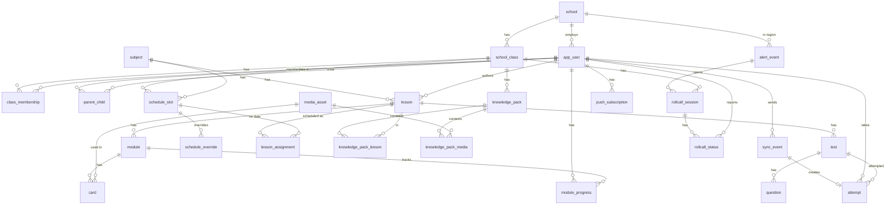

# ShelterED — чернетка схеми БД (B2)

Статус: **чернетка для обговорення**, 19.10.2026, бекенд (Стас). За нею пишуться SQLAlchemy-моделі й міграції в епіку B2. Джерело — план бекенду, підзадачі B2.1–B2.6.

Місця, де потрібне рішення команди, позначені **❓** і зібрані в кінці документа.

## Загальні правила

- **Ідентифікатори** — `uuid`. Для подій, спроб, прогресу й статусів переклички id створює клієнт ще офлайн (принцип 2 offline-first); сервер приймає його як є. ❓1
- **Час** — завжди `timestamptz` в UTC. Час розкладу (`time` без дати) — у поясі школи (`Europe/Kyiv`).
- Дві мітки часу для всього, що приходить з пристрою: `occurred_at` / `*_at_client` (годинник пристрою) і `received_at` (годинник сервера). Різниця між ними — основа перевірки часу (B9.4).
- **Переліки** (статуси, ролі, типи) — `text` + `CHECK (... IN (...))`, а не PostgreSQL `ENUM`: нове значення додається простою міграцією, яка відкочується.
- Імена обмежень задає naming convention у `app/models/base.py` (`pk_*`, `fk_*`, `uq_*`, `ix_*`, `ck_*`).
- `created_at` / `updated_at` (`timestamptz`, default `now()`) — у всіх таблицях, де дані редагуються; нижче не повторюються.
- Імена таблиць в однині. `user` і `class` — зарезервовані слова, тому `app_user` і `school_class`.
- Мінімум персональних даних про дітей (B15.1): жодних email, телефонів, дат народження учнів.

## ER-діаграма

---

## B2.1 Організаційна структура

### `school`
| Поле | Тип | Примітка |
|---|---|---|
| id | uuid PK | |
| name | text NOT NULL | |
| region_code | text NOT NULL | регіон для API тривог; формат залежить від обраного API ❓9 |
| timezone | text NOT NULL default `'Europe/Kyiv'` | для логіки розкладу |

Індекс: `ix_school_region_code` — B7.2 шукає всі школи регіону при тривозі.

### `school_class`
| Поле | Тип | Примітка |
|---|---|---|
| id | uuid PK | |
| school_id | uuid FK → school ON DELETE CASCADE | |
| name | text NOT NULL | «7-А» |
| grade | smallint CHECK 1..11 | |
| academic_year | text NOT NULL | «2026/2027» |
| join_code | text UNIQUE NOT NULL | код класу для входу учнів (B3.3, B5.1); зберігається нормалізованим: лише `A-Z0-9` (`normalize_link_code`, CHECK `ck_school_class_join_code_format`), на вході нормалізується так само |
| join_code_expires_at | timestamptz NULL | щоб старий код можна було відкликати; обмежує лише створення нових учнів, наявні входять і після нього |

UNIQUE (`school_id`, `academic_year`, `name`).

### `app_user`
| Поле | Тип | Примітка |
|---|---|---|
| id | uuid PK | |
| role | text CHECK IN (`student`, `teacher`, `parent`, `admin`) | одна роль на акаунт ❓3; роль психолога — відкрите питання плану |
| display_name | text NOT NULL, ≤ 50 | ім'я; для учня — те, яке вводить сам ❓2 |
| last_name | text NULL, ≤ 50 | прізвище; у БД допускаємо NULL (вчитель / адміністрація можуть не вказувати), для учня його вимагає API ❓2 |
| school_id | uuid FK → school NULL | NULL для батьків |
| email | citext UNIQUE NULL | лише вчитель / батьки / адміністрація; в учня завжди NULL |
| password_hash | text NULL | NULL для учня (вхід за кодом класу) |
| pin_hash | text NULL | PIN учня (argon2); NULL після скидання вчителем. Лише для `student` |
| name_key | text NULL, індекс | нормалізовані імʼя+прізвище учня для пошуку в класі; у дорослих NULL |
| token_version | integer NOT NULL default 0 | епоха облікових даних: скидання PIN збільшує; access-токен несе `ver`, refresh-токен зберігає версію |
| is_active | boolean default true | |
| last_seen_at | timestamptz NULL | |

CHECK: `role <> 'student' OR (email IS NULL AND password_hash IS NULL)`; `role = 'student' OR pin_hash IS NULL`.

### `class_membership`
| Поле | Тип | Примітка |
|---|---|---|
| class_id | uuid FK → school_class ON DELETE CASCADE | PK (class_id, user_id) |
| user_id | uuid FK → app_user ON DELETE CASCADE | |
| member_role | text CHECK IN (`student`, `teacher`) | вчитель може вести кілька класів |
| joined_at | timestamptz default now() | |

Індекс: `ix_class_membership_user_id` — «мої класи» для вчителя, «мій клас» для учня; на ньому тримаються перевірки доступу (B3.4).

### `parent_child`
| Поле | Тип | Примітка |
|---|---|---|
| parent_id | uuid FK → app_user ON DELETE CASCADE | PK (parent_id, child_id) |
| child_id | uuid FK → app_user ON DELETE CASCADE | |
| linked_at | timestamptz default now() | |

Індекс: `ix_parent_child_child_id`. Одноразові коди прив'язки — таблиця `parent_link_code` (розділ «Авторизація» нижче).

---

## B2.2 Навчальний контент

### `subject`
| Поле | Тип | Примітка |
|---|---|---|
| id | uuid PK | |
| school_id | uuid FK → school NULL | NULL = загальний довідник ❓10 |
| name | text NOT NULL | «Математика» |

### `lesson`
| Поле | Тип | Примітка |
|---|---|---|
| id | uuid PK | |
| subject_id | uuid FK → subject | |
| author_id | uuid FK → app_user | вчитель |
| title | text NOT NULL | |
| shelter_part | text NOT NULL | укриттєва частина перевернутого уроку: опис / інструкція |
| main_part | text NOT NULL | основна частина |
| status | text CHECK IN (`draft`, `published`) default `draft` | |
| version | integer NOT NULL default 1 | +1 при кожній зміні опублікованого уроку; пакет пам'ятає версію (B6.4) |
| published_at | timestamptz NULL | |
| grade | smallint NULL | для фільтрів |

Урок не прив'язаний до класу напряму: один урок можна провести в кількох класах через розклад ❓4.

### `module`
Мікро-модуль 3–5 хв.
| Поле | Тип | Примітка |
|---|---|---|
| id | uuid PK | |
| lesson_id | uuid FK → lesson ON DELETE CASCADE | |
| part | text CHECK IN (`shelter`, `main`) | до якої частини уроку належить |
| position | smallint NOT NULL | порядок |
| title | text NOT NULL | |
| duration_min | smallint CHECK 1..10 | орієнтир 3–5 |

UNIQUE (`lesson_id`, `part`, `position`).

### `card`
| Поле | Тип | Примітка |
|---|---|---|
| id | uuid PK | |
| module_id | uuid FK → module ON DELETE CASCADE | |
| position | smallint NOT NULL | UNIQUE (module_id, position) |
| kind | text CHECK IN (`text`, `image`, `video`) | |
| body | jsonb NOT NULL | текст / розмітка картки |
| media_asset_id | uuid FK → media_asset NULL | для image / video |

### `test`
| Поле | Тип | Примітка |
|---|---|---|
| id | uuid PK | |
| lesson_id | uuid FK → lesson ON DELETE CASCADE | |
| title | text NOT NULL | |
| window_enabled | boolean default false | тест із вікном (B11.1) |
| window_hours | smallint NULL CHECK IN (24, 48, 72) | обов'язкове, якщо `window_enabled` |

### `question`
| Поле | Тип | Примітка |
|---|---|---|
| id | uuid PK | |
| test_id | uuid FK → test ON DELETE CASCADE | |
| position | smallint NOT NULL | UNIQUE (test_id, position) |
| kind | text CHECK IN (`single`, `multiple`) | |
| prompt | text NOT NULL | |
| options | jsonb NOT NULL | `[{"id": "a", "text": "..."}]` |
| answer_key | jsonb NOT NULL | правильні `id`; у пакет — лише для тренувального тесту (`window_enabled = false`) |
| points | smallint default 1 | |

### `media_asset`
| Поле | Тип | Примітка |
|---|---|---|
| id | uuid PK | |
| kind | text CHECK IN (`video`, `image`, `subtitles`) | |
| storage_key | text UNIQUE NOT NULL | шлях в об'єктному сховищі або томі (відкрите питання плану) |
| mime_type | text NOT NULL | |
| size_bytes | bigint NOT NULL | для лімітів пакета (B6.5) |
| sha256 | text NOT NULL | кешування й дедуплікація |
| duration_s | integer NULL | для відео |
| subtitles_id | uuid FK → media_asset NULL | VTT до відео; публікація відео без субтитрів заборонена (B5.3) |
| uploaded_by | uuid FK → app_user | |

---

## B2.3 Розклад

### `schedule_slot`
Постійний тижневий слот.
| Поле | Тип | Примітка |
|---|---|---|
| id | uuid PK | |
| class_id | uuid FK → school_class ON DELETE CASCADE | |
| subject_id | uuid FK → subject | |
| weekday | smallint CHECK 1..7 | ISO: 1 = понеділок |
| starts_at | time NOT NULL | місцевий час школи |
| ends_at | time NOT NULL | CHECK ends_at > starts_at |
| valid_from | date NOT NULL | межі семестру |
| valid_to | date NULL | |

Індекс: (`class_id`, `weekday`) — «який урок зараз» (B5.2).

### `schedule_override`
Перевизначення на конкретну дату.
| Поле | Тип | Примітка |
|---|---|---|
| id | uuid PK | |
| class_id | uuid FK → school_class ON DELETE CASCADE | |
| date | date NOT NULL | |
| slot_id | uuid FK → schedule_slot NULL | NULL для додаткового уроку |
| kind | text CHECK IN (`cancel`, `replace`, `extra`) | |
| subject_id | uuid FK → subject NULL | для replace / extra |
| starts_at, ends_at | time NULL | для replace / extra |

### `lesson_assignment`
Який урок іде в слоті в конкретну дату (B5.3 «прив'язка уроку до слоту»). У плані урок прив'язаний до слоту; оскільки урок щотижня різний, прив'язка робиться на дату ❓4.
| Поле | Тип | Примітка |
|---|---|---|
| slot_id | uuid FK → schedule_slot ON DELETE CASCADE | PK (slot_id, date) |
| date | date | |
| lesson_id | uuid FK → lesson | |

---

## B2.4 Пакети знань «Рюкзак»

### `knowledge_pack`
| Поле | Тип | Примітка |
|---|---|---|
| id | uuid PK | |
| class_id | uuid FK → school_class ON DELETE CASCADE | пакет = клас + дата |
| pack_date | date NOT NULL | |
| version | integer NOT NULL | UNIQUE (class_id, pack_date, version); актуальна — найбільша |
| content_hash | text NOT NULL | sha256 канонічного JSON вмісту без id, версії й часу збірки; він же ETag (B6.3) |
| size_bytes | bigint NOT NULL | розмір JSON без стиснення (B6.5); медіа рахуються окремо |
| built_at | timestamptz NOT NULL | |
| content_gzip | bytea NOT NULL | готова відповідь `GET /packs/{id}`: канонічний JSON, gzip (B6, міграція `0edf076a683a`) |

Версія пакета незмінна: новий вміст → нова версія, стара лишається доступною за id.

### `knowledge_pack_lesson`
| Поле | Тип | Примітка |
|---|---|---|
| pack_id | uuid FK → knowledge_pack ON DELETE CASCADE | PK (pack_id, lesson_id) |
| lesson_id | uuid FK → lesson | |
| lesson_version | integer NOT NULL | версія уроку на момент збірки |

### `knowledge_pack_media`
| Поле | Тип | Примітка |
|---|---|---|
| pack_id | uuid FK → knowledge_pack ON DELETE CASCADE | PK (pack_id, media_asset_id) |
| media_asset_id | uuid FK → media_asset | |

---

## B2.5 Результати й події

### `sync_event`
Журнал усіх подій з пристроїв — основа ідемпотентності (B9.2).
| Поле | Тип | Примітка |
|---|---|---|
| client_event_id | uuid PK | створює клієнт; `INSERT ... ON CONFLICT DO NOTHING` |
| type | text CHECK IN (`module_progress`, `test_attempt`, `rollcall_status`, `survey_answer`) | |
| user_id | uuid FK → app_user | автор події (учень) |
| device_id | uuid NOT NULL | id пристрою, який створює клієнт ❓7 |
| occurred_at | timestamptz NOT NULL | годинник пристрою |
| received_at | timestamptz default now() | годинник сервера |
| clock_skew_ms | bigint NULL | зсув годинника пристрою з пакета (B9.4) |
| is_suspicious | boolean default false | час у майбутньому / великий зсув — позначка, не блокування |
| source | text CHECK IN (`online`, `qr`) default `online` | QR — B10 |
| relayed_by | uuid FK → app_user NULL | вчитель, який передав QR-події (B10.3) |
| payload | jsonb NOT NULL | |
| status | text CHECK IN (`accepted`, `rejected`) | |
| reject_reason | text NULL | |

Індекс: (`user_id`, `received_at`). Курсор для `GET /sync/changes` -- див. «Рішення B9».

### `attempt`
Спроба тесту.
| Поле | Тип | Примітка |
|---|---|---|
| id | uuid PK | |
| client_event_id | uuid UNIQUE FK → sync_event | одна подія — одна спроба |
| student_id | uuid FK → app_user | |
| test_id | uuid FK → test | |
| answers | jsonb NOT NULL | `{"<question_id>": ["a"]}` |
| completed_at_client | timestamptz NOT NULL | для вікна тесту рахується саме він (B11.3) |
| received_at | timestamptz default now() | |
| score | numeric(5,2) NULL | рахує сервер за `answer_key` (B11.4) |
| credit_status | text CHECK IN (`credited`, `not_credited_late`, `not_credited_repeat`) | |
| is_suspicious | boolean default false | |

Частковий UNIQUE (`student_id`, `test_id`) WHERE `credit_status = 'credited'` — у БД неможливо зарахувати дві спроби (B9.3: перша завершена).

### `module_progress`
| Поле | Тип | Примітка |
|---|---|---|
| student_id | uuid FK → app_user ON DELETE CASCADE | PK (student_id, module_id) |
| module_id | uuid FK → module ON DELETE CASCADE | |
| progress_pct | smallint CHECK 0..100 | оновлення через `GREATEST` — беремо максимум (B9.3) |
| completed_at_client | timestamptz NULL | |
| full_at | timestamptz NULL | `occurred_at` найранішої прийнятої події з 100% — момент завершення модуля (`LEAST`); вікно тесту B11, день навчання B14 |
| last_event_id | uuid FK → sync_event | остання подія, яка змінила рядок |

---

## B2.6 Безпека

### `alert_event`
| Поле | Тип | Примітка |
|---|---|---|
| id | uuid PK | |
| region_code | text NOT NULL | |
| school_id | uuid FK → school NULL | запис для кожної школи регіону (B7.2) |
| class_id | uuid FK → school_class NULL | ручна тривога для класу (B7.3) |
| source | text CHECK IN (`api`, `manual`) | |
| external_id | text NULL | id тривоги провайдера (бекенд опитує API сам, B7); унікальний індекс `uq_alert_event_source_region_external_school` (source, region_code, external_id, school_id) NULLS NOT DISTINCT WHERE external_id IS NOT NULL — повтори ігноруються, NULL у school_id не обходить унікальність; відбій — `ended_at` того самого рядка, а не окрема подія; ручні тривоги без external_id можуть повторюватися (B7.1) |
| is_drill | boolean default false | тренувальна |
| started_at | timestamptz NOT NULL | |
| ended_at | timestamptz NULL | відбій |
| created_by | uuid FK → app_user NULL | вчитель для ручної |

Індекс: (`school_id`, `started_at`) — журнал тривог школи (B14.4). Частковий індекс для `GET /alerts/active`: WHERE `ended_at IS NULL`.

### `alert_source` (B7.6)
| Поле | Тип | Примітка |
|---|---|---|
| name | text PK | провайдер, напр. `alerts.in.ua` |
| last_success_at | timestamptz NULL | останнє успішне опитування; давніше `ALERTS_SOURCE_STALE_S` → `source_available = false` |
| last_attempt_at | timestamptz NULL | |
| last_error | text NULL | лише тип помилки (без тексту: там може бути URL із токеном) |

### `rollcall_session`
| Поле | Тип | Примітка |
|---|---|---|
| id | uuid PK | |
| class_id | uuid FK → school_class ON DELETE CASCADE | |
| alert_event_id | uuid FK → alert_event NULL | NULL, якщо відкрив вчитель вручну |
| opened_by | uuid FK → app_user NULL | NULL при автовідкритті |
| is_drill | boolean default false | |
| opened_at | timestamptz NOT NULL | |
| closed_at | timestamptz NULL | закривається з відбоєм останньої тривоги, що покриває клас (B12.1) |

Частковий UNIQUE (`class_id`) WHERE `closed_at IS NULL` — не більше однієї відкритої переклички на клас.

### `rollcall_status`
| Поле | Тип | Примітка |
|---|---|---|
| session_id | uuid FK → rollcall_session ON DELETE CASCADE | PK (session_id, student_id) |
| student_id | uuid FK → app_user ON DELETE CASCADE | |
| status | text CHECK IN (`safe`, `in_shelter`) | «Немає відповіді» = рядка немає ❓6 |
| occurred_at | timestamptz NOT NULL | годинник пристрою; перемагає найпізніший (B9.3) |
| received_at | timestamptz NOT NULL | видно, чи статус міг застаріти (B12.3) |
| last_event_id | uuid FK → sync_event | |

Оновлення: `INSERT ... ON CONFLICT (session_id, student_id) DO UPDATE ... WHERE excluded.occurred_at > rollcall_status.occurred_at`.

### `push_subscription`
| Поле | Тип | Примітка |
|---|---|---|
| id | uuid PK | |
| user_id | uuid FK → app_user ON DELETE CASCADE | кілька пристроїв на користувача (B8.2) |
| endpoint | text UNIQUE NOT NULL | URL push-сервісу браузера |
| p256dh | text NOT NULL | ключі підписки |
| auth | text NOT NULL | |
| last_success_at | timestamptz NULL | метрики (B8.5) |
| failed_at | timestamptz NULL | 404/410 → видалити (B8.4) |

---

## Авторизація (B3)

Токени й коди зберігаються лише як SHA-256 хеш.

### `refresh_token`
| Поле | Тип | Примітка |
|---|---|---|
| id | uuid PK | |
| user_id | uuid FK → app_user ON DELETE CASCADE | |
| family_id | uuid NOT NULL | спільний для всіх токенів одного входу; індекс `ix_refresh_token_family_id`; також `ix_refresh_token_user_id` |
| token_hash | text UNIQUE NOT NULL | |
| expires_at | timestamptz NOT NULL | 30 днів |
| rotated_at | timestamptz NULL | токен ротовано (звичайна заміна); дає право на повтор у межах вікна |
| revoked_at | timestamptz NULL | вихід, скидання PIN або відкликана родина; такий токен не працює ніколи |
| replaced_by_id | uuid FK → refresh_token NULL | найновіший токен, виданий замість цього (при повторі переставляється) |
| token_version | integer NOT NULL default 0 | `app_user.token_version` на момент видачі |
| created_at | timestamptz default now() | |
| user_agent | text NULL | без IP-адреси |

### `auth_code`
Код авторизації OAuth 2.0 PKCE.
| Поле | Тип | Примітка |
|---|---|---|
| id | uuid PK | |
| code_hash | text UNIQUE NOT NULL | |
| user_id | uuid FK → app_user ON DELETE CASCADE | |
| code_challenge | text NOT NULL | S256 |
| client_id | text NOT NULL | |
| redirect_uri | text NULL | |
| expires_at | timestamptz NOT NULL | 60 с |
| used_at | timestamptz NULL | одноразовий |

### `parent_link_code`
| Поле | Тип | Примітка |
|---|---|---|
| id | uuid PK | |
| code_hash | text UNIQUE NOT NULL | |
| child_id | uuid FK → app_user ON DELETE CASCADE | |
| created_by | uuid FK → app_user ON DELETE SET NULL | вчитель або адмін |
| expires_at | timestamptz NOT NULL | 7 днів |
| used_at | timestamptz NULL | одноразовий |
| used_by | uuid FK → app_user ON DELETE SET NULL | батьки, які ввели код |

---

## Поза B2 (з'явиться у своїх епіках)

- Ключ пристрою для підпису QR — B10.2 (можливо, разом із таблицею `device` ❓7).
- Відповіді опитування «як ти зараз?» і журнал доступу до них — B13.4 / B15.4, окремо від решти даних.
- Агрегати (прогрес класу, мапа знань) — B9.6 / B14, див. «Рішення B14».

## Рішення (раніше ❓)

Усі питання закрито 01.11.2026.

1. **UUID** — ✅ сервер приймає будь-який валідний клієнтський UUID як є. Для рядків, які створює сервер, `uuid4`; v7 — коли погодимо бібліотеку.
2. **Дані учня** — ✅ ім'я та прізвище учня (`display_name`, `last_name`), без email і телефону.
3. **Одна роль на акаунт** — ✅ `app_user.role` з `CHECK`; вчитель-батько матиме два акаунти.
4. **Урок ↔ клас** — ✅ лише через розклад на дату (`lesson_assignment`), без `lesson.class_id`.
5. **Ключ відповідей** — ✅ лишається в `question`; чи йде в пакет — питання збірки пакета, не схеми.
6. **«Немає відповіді» в перекличці** — ✅ рядка немає, статусу `no_response` не існує.
7. **Пристрої** — ✅ `device_id` — звичайний uuid, таблиці `device` поки немає.
8. **Видалення даних учня** — ✅ повне видалення, `ON DELETE CASCADE` від користувача до його даних.
9. **`region_code`** — ✅ звичайний `text`.
10. **Предмети** — ✅ `subject.school_id = NULL` означає загальний довідник.

> `alert_event`: унікальний індекс `uq_alert_event_source_region_external_school` частковий, тому ідемпотентна вставка має бути `on_conflict_do_nothing(index_elements=[...], index_where=text("external_id IS NOT NULL"))`, а не `constraint=`.

## Рішення B5 (05.11.2026)

Міграція `b8f50e29ecc5`: UNIQUE (`schedule_override.slot_id`, `date`) — не більше одного перевизначення слота на дату (extra без слота не обмежені); індекси `ix_schedule_override_class_id_date`, `ix_lesson_assignment_lesson_id`, `ix_lesson_author_id`. Нових полів про дітей немає.

- **Клієнтські id й ідемпотентність.** Створення (`POST` класу, предмета, слота, перевизначення, уроку, модуля, картки, тесту, питання; `PUT /media/{id}`) приймає `id` від клієнта: `INSERT ... ON CONFLICT (id) DO NOTHING`. Повтор із тими самими даними → 200 і наявний ресурс, той самий id з іншими даними чи іншим власником → 409 `ID_CONFLICT`. Інші записи ідемпотентні за природою (PATCH, PUT прив'язок, DELETE відсутнього → 204).
- **Класи.** Пише лише адміністрація своєї школи; `join_code` генерує сервер (`new_link_code`), перегенерація одразу робить старий код недійсним для нових учнів. Видалити можна лише клас без учнів (409 `CLASS_NOT_EMPTY`), бо CASCADE зніс би перекличку й пакети.
- **Розклад.** Слоти й перевизначення пише адміністрація; читають учні, вчителі класу й адміністрація. Видалення слота видаляє його перевизначення й прив'язки уроків (щоб завершити слот без втрати історії — `valid_to`). «Який урок зараз» — чисті функції `app/services/schedule.py` (`resolve_day`, `current_item`) у поясі `school.timezone`; межі уроку `[початок, кінець)`; неоднозначна година при переході на зимовий час — `fold=0`.
- **Уроки.** Пише лише автор (вчитель); адміністрація й інші вчителі школи читають, учні й батьки — ні (їм урок прийде в пакеті B6). **Опублікований урок незмінний** (409 `LESSON_PUBLISHED`): вчитель робить `unpublish` → правки → `publish`; повторна публікація збільшує `version`. Прив'язки в розкладі при цьому лишаються, пакети беруть лише опубліковані уроки. Видалити можна лише чернетку без прив'язок і результатів (409 `LESSON_IN_USE`).
- **Публікація** перевіряє все разом і повертає 422 `LESSON_NOT_PUBLISHABLE` зі списком у `details`: `shelter_part` не порожня; кожне відео має VTT-субтитри; урок ≤ `PACK_MAX_DAY_BYTES`; пакети днів, де урок уже стоїть, ≤ ліміту. Розмір = текст уроку (octet_length полів) + унікальні медіа карток із їхніми субтитрами.
- **Прив'язка уроку** (`lesson_assignment`): лише вчитель цього класу, лише опублікований урок своєї школи, лише в день слота й не в скасований слот. Пакет класу на дату (унікальні уроки слотів, що справді йдуть цього дня за розкладом: без скасованих і недійсних слотів) ≤ 50 МБ, інакше 422 `PACK_DAY_LIMIT_EXCEEDED`. Додаткові уроки (`extra`) без слота поки не мають прив'язки уроку.
- **Медіа.** `PUT /media/{id}?kind=` із сирим тілом (не multipart, без нових залежностей): потік пишеться в тимчасовий файл із перевіркою розміру на льоту, потім атомарно перейменовується. Тип перевіряється за `Content-Type` і сигнатурою; VTT — UTF-8. Ключ `<kind>/<id>-<random>.<ext>`, ім'я файла від клієнта не використовується. Ліміти: відео 30 МБ, зображення 2 МБ, VTT 200 КБ. Сховище — `LocalMediaStorage` (`MEDIA_ROOT`, URL `MEDIA_URL_PREFIX`) за інтерфейсом `MediaStorage` (`app/core/storage.py`) для заміни на S3. До картки можна прикріпити лише власний файл вчителя; відв'язати субтитри від відео опублікованого уроку не можна; заміна субтитрів такого відео ставить `packs.rebuild_for_lesson` для кожного опублікованого уроку з ним.

## Рішення B7 «Тривоги» (05.11.2026)

Міграція `39ee76b5434f`: ключ дедуплікації тривог `uq_alert_event_source_region_external_school` (source, region_code, external_id, school_id) замість (source, external_id, school_id); таблиця `alert_source`. Нових полів про дітей немає.

- **Провайдер.** alerts.in.ua (`GET https://api.alerts.in.ua/v1/alerts/active.json`, `Authorization: Bearer`), за інтерфейсом `AlertProvider` (`app/services/alert_provider.py`) — інше API підключається новим класом. Токен — `ALERTS_API_TOKEN` (порожній → опитування вимкнене), у логи не потрапляє; у `alert_source.last_error` — лише код (`timeout`, `http_429`, `invalid_response`).
- **`school.region_code`** = id області провайдера як текст (`location_uid`: «31» — м. Київ, «14» — Київська область). Беремо лише тривоги рівня регіону будь-якого типу: `location_type = oblast` або `city` для міст зі спеціальним статусом (`REGION_CITY_UIDS`: «31» — м. Київ, «30» — м. Севастополь); тривоги району, громади чи звичайного міста не вмикають тривогу для всього регіону.
- **Опитування** — Celery beat `alerts.poll` (черга `default`, `ALERTS_POLL_INTERVAL_S` = 30 с). Стан-орієнтоване: активна тривога → рядок `alert_event` для кожної школи регіону (`ON CONFLICT DO NOTHING`); тривога зникла з активних → відбій (`ended_at` = час опитування, `UPDATE ... WHERE ended_at IS NULL`). Помилка API — не відбій. Відповідь із невалідними записами (не пройшли валідацію) — неповна: нові тривоги з неї журналюються, але відбою в цьому опитуванні немає (у лог — попередження з кількістю пропущених записів). Тривога, що знову з'явилась після відбою (API на мить її «загубило»), відновлюється (`ended_at = NULL`) і реакція повторюється. Повторні й паралельні запуски не дублюють рядків, перекличок і push.
- **Реакція** на початок тривоги з API: класи школи, де зараз іде урок за розкладом (`current_lesson`, Europe/Kyiv) → сесія переклички (`rollcall_session`, одна відкрита на клас; B12 додасть відмітки) + push `alert` з `lesson_id`. Відбій закриває сесії переклички цієї тривоги й ставить push `all_clear` тим самим класам — лише якщо клас не покриває інша активна тривога (ручна цього класу або з API його школи). Інакше сесія лишається відкритою й переходить до найранішої з активних тривог (`alert_event_id` і `is_drill` оновлюються), без `all_clear`; закриється з відбоєм останньої.
- **Push** (B8 ще не реалізований): єдина функція `enqueue_push` (`app/workers/push.py`) ставить задачу `push.send` у чергу `push` з payload `{type, class_id, alert_id?, lesson_id?, pack_id?, pack_date?}` — без персональних даних. Задачі ставляться лише після commit; недоступний брокер логується, а не ламає запит (запасний шлях — `GET /alerts/active`).
- **Ручна тривога** (`POST /alerts/manual`): вчитель цього класу **або адміністрація його школи** (контракт змінено: раніше лише вчитель). `id` від клієнта, повтор → 200 без нового push. Перекличка відкривається навіть без уроку зараз; `lesson_id` у push — якщо урок іде. `is_drill` зберігається в тривозі й сесії переклички. Відбій (`POST /alerts/{id}/end`) — вчитель класу або адміністрація; тривога з API вручну не закінчується (409 `ALERT_NOT_MANUAL`).
- **`GET /alerts/active`**: тривоги з API шкіл користувача + ручні тривоги його класів (батьки — шкіл і класів дітей, адміністрація — усе по школі). `source_available = false`, якщо опитування вимкнене або останній успіх давніший за `ALERTS_SOURCE_STALE_S` (300 с).
- **Журнал** `GET /alerts`: адміністрація своєї школи, `from`/`to` — дати за київським часом.

## Рішення B6 «Рюкзак» (05.11.2026)

Міграція `0edf076a683a`: `knowledge_pack.content_gzip` (bytea NOT NULL; наявні рядки без вмісту видаляються — пакети похідні й перезбираються). Нових полів про дітей немає.

- **Вміст пакета** (клас + дата): розклад дня, опубліковані уроки дня (модулі — спершу укриттєва частина, картки, тести й питання; `answer_key` — лише в питаннях тренувального тесту (`window_enabled = false`) для миттєвої перевірки офлайн, у тесті з вікном (B11, оцінюваному) поля немає зовсім — оцінює сервер після синхронізації. Ключ тренувального тесту входить у хеш, тож його виправлення дає нову версію пакета. Інших оцінюваних вправ у моделі немає: картки (`text`/`image`/`video`) — лише контент, відповіді на них лишаються на пристрої), `explanations` (поки порожній список, сховища пояснень немає — B13.3). Урок, знятий з публікації, у пакет не йде, а в розкладі пакета його `lesson_id = null`. День без уроків у розкладі пакета не має.
- **Версія й хеш.** `content_hash` = sha256 канонічного JSON (сортовані ключі, без пробілів, UTF-8) вмісту без `id`, `version`, `built_at`. Той самий вміст → той самий хеш → нова версія не створюється (повтор і паралельна перезбірка нічого не дублюють; гонку версій ловить UNIQUE (class_id, pack_date, version) + `ON CONFLICT DO NOTHING`; програвша збірка перечитує дані й збирає пакет знову — до 3 спроб, тож виграють найсвіжіші дані). У хешований вміст входить `media` — id медіа уроків разом із субтитрами, тож заміна субтитрів дає нову версію. Готова відповідь зберігається в `content_gzip`, тому ETag завжди відповідає тілу.
- **Перезбірка** — Celery (черга `default`): `packs.rebuild_for_lesson` після `publish`/`unpublish`; `packs.rebuild_class` після змін слотів, перевизначень і прив'язок уроків; `packs.refresh_all` — beat раз на `PACKS_REFRESH_INTERVAL_S` (3600 с): новий день у горизонті 7 днів і все, що могло не перезібратися (недоступний брокер). Нова версія хоч одного дня → **один** push `pack_updated` класу за перезбірку (`class_id`, `pack_id` і `pack_date` найранішого зміненого дня).
- **Прогрес не губиться при зміні уроку.** Версія пакета незмінна, стара лишається доступною за id (`GET /packs/{old_id}`), пристрій тримає її, доки учень не закінчить. Id модулів, карток, тестів і питань стабільні між версіями уроку (правка — `unpublish` → зміни → `publish`, id ті самі), тож прогрес і спроби (B9) прив'язані до них, а не до версії пакета; `knowledge_pack_lesson.lesson_version` фіксує, з якою версією уроку зібрано пакет.
- **Маніфест** `GET /packs/manifest?class_id&from&to`: найновіша версія кожного дня, діапазон до 7 днів (за замовчуванням сьогодні..+6 за часом школи; інакше 422 `VALIDATION_ERROR`). Медіа (з субтитрами) — лише для днів «сьогодні + завтра» в межах діапазону, з URL сховища, розміром, sha256 і `needed_on`.
- **Завантаження** `GET /packs/{id}`: `ETag` = `"<content_hash>"`, `If-None-Match` → 304; gzip, якщо клієнт його приймає (`Accept-Encoding` з q-значеннями: `gzip`/`x-gzip` або `*` з q > 0; `gzip;q=0` — без стиснення; brotli не додаємо — немає залежності); `Cache-Control: private, no-cache`, `Vary: Accept-Encoding`.
- **Доступ:** учень свого класу, вчитель своїх класів, адміністрація школи; батьки — ні (403).
- **Ліміти й розміри.** `size_bytes` — JSON без стиснення. Кожна збірка логує `json_bytes` і `media_bytes` (без персональних даних). День > `PACK_MAX_DAY_BYTES` (50 МБ) чи 7 днів > `PACK_MAX_WEEK_BYTES` (200 МБ) → попередження в лог, пакет усе одно збирається (блокує ліміт дня при прив'язці уроку, B5).

## Рішення B9 «Синхронізація» (05.11.2026)

Міграція `827ed8465b1b`: послідовність `sync_change_seq`, функція `sync_change_stamp()` і тригери `<table>_sync_change` (BEFORE INSERT OR UPDATE) на `attempt`, `module_progress`, `rollcall_status`; у цих таблицях колонки `change_seq` (bigint NOT NULL) і `change_xid` (bigint NOT NULL, `pg_current_xact_id()` -- xid8, що вміщується в bigint) та індекси `ix_<table>_sync_changes` (`student_id`, `change_xid`, `change_seq`). Код ці колонки не пише (у моделях `server_default=FetchedValue()`). Нових полів про дітей немає.

- **Прийом** (`app/services/sync.py`): кожна подія -- окрема транзакція (commit після кожної); `INSERT INTO sync_event ... ON CONFLICT (client_event_id) DO NOTHING RETURNING`, програвший паралельний запит чекає на commit переможця й повертає збережений результат. Відхилена подія записується з `status = rejected` і причиною; `unknown_type` не записується (CHECK), але результат той самий. `received_at` -- один час сервера на пакет; `clock_skew_ms = received_at - sent_at`; `is_suspicious`, якщо `|зсув|` чи `occurred_at - received_at` > `SYNC_SUSPICIOUS_SKEW_S` (300 с).
- **Доступ:** модуль/тест -- урок був у будь-якій версії пакета класу учня (`knowledge_pack_lesson`) або прив'язаний до слота його класу (`lesson_assignment`); перекличка -- учень класу сесії.
- **Зарахування спроби:** `pg_advisory_xact_lock` на (учень, тест) серіалізує паралельні спроби; частковий UNIQUE `uq_attempt_student_id_test_id_credited` -- остання лінія захисту. Вікно тесту -- див. «Рішення B11».
- **Стрічка змін:** порядок і курсор -- (`change_xid`, `change_seq`), фільтр `change_xid < pg_snapshot_xmin(pg_current_snapshot())`; див. `docs/sync-protocol.md`, розділ 8.
- **Агрегати** (B9.6: прогрес класу, мапа знань) — див. «Рішення B14» (Celery, черга `default`).

## Рішення B12 «Перекличка» (05.11.2026)

Міграцій немає, нових полів про дітей немає.

- **Відмітка учня** -- лише подією `rollcall_status` через `POST /sync/events` (B9): конфлікт -- найпізніший `occurred_at`; статус з `occurred_at` після `closed_at` -- `session_closed`, раніший (офлайн до відбою) приймається й після закриття.
- **Ручний старт** `POST /classes/{id}/rollcall` -- вчитель цього класу (адмін -- ні, як у контракті). `id` від клієнта: повтор -- 200 з наявною сесією (навіть закритою); інша відкрита сесія класу (зокрема від тривоги) -- 409 `ROLLCALL_ALREADY_OPEN` з `details.session_id`; той самий id з іншим `is_drill` чи класом -- 409 `ID_CONFLICT`. Push при ручному старті не шлеться (немає типу push; учні бачать сесію через `GET .../rollcall/current`).
- **Закриття** `POST /classes/{id}/rollcall/{session_id}/close` -- вчитель класу, ідемпотентно; сесія іншого класу -- 404.
- **Перегляд** `GET /classes/{id}/rollcall/current` -- лише відкрита сесія; вчитель і адмін школи -- увесь клас (за прізвищем), учень -- лише себе (і `summary` лише по собі); «немає відповіді» = нема рядка. `ETag` (sha256 тіла) + `If-None-Match` → 304 для опитування кожні 10 с; `Cache-Control: private, no-cache`.
- **Батьки** `GET /students/{id}/rollcall/current` -- найновіша відкрита сесія класів дитини; немає -- `session_id`/`status` = null.
- Не зроблено: push батькам при зміні статусу (B12.4, разом із B8 Олега), кількість дітей в укритті по школі для адміна (B12.5, P2).

## Рішення B14 «Кабінети» (05.11.2026)

Міграція `69af2adf1d7f`: `module_progress.full_at` (заповнюється з журналу `sync_event`) і таблиці агрегатів `student_lesson_stat` (PK student_id, lesson_id), `student_test_stat` (PK student_id, test_id), `student_study_day` (PK student_id, day), `class_lesson_stat` (PK class_id, lesson_id), `class_question_stat` (PK class_id, question_id); усі FK з `ON DELETE CASCADE` (видалення учня, класу чи уроку прибирає агрегати). Лише id і числа — нових персональних полів про дітей немає.

- **Агрегати рахує Celery** (`app/services/stats.py`, черга `default`): `stats.recompute_student` — після commit пакета `POST /sync/events`, у якому є прийняті події (одна задача на пакет, а не на подію; помилка брокера не ламає прийом); `stats.refresh_all` — beat раз на `STATS_REFRESH_INTERVAL_S` (3600 с). Перерахунок — повна заміна рядків учня, потім (окремою транзакцією, з уже закоміченими рядками учнів) його класів, під `pg_advisory_xact_lock`: повтор і паралельні задачі дають той самий результат. Ендпоінти читають лише готові рядки (`computed_at` показує свіжість).
- **Урок учня** — опублікований урок, призначений класу учня на дату ≤ сьогодні (пояс школи), або урок, з якого є прогрес чи спроби. **Урок завершено** — усі поточні модулі 100%; час завершення — найпізніший `full_at` модулів (годинник пристрою).
- **Час навчання** — сума `module.duration_min` завершених модулів (плановий час 3–5 хв), день — дата `full_at` у поясі школи. Різницю позначок часу пристрою не використовуємо: її не перевірити, а відкритий екран її завищує; спроби тестів час не додають. Тож показник консервативний (нижня оцінка).
- **Тест складено** — оцінка зарахованої спроби ≥ `STATS_PASS_SCORE` (60 %). Статус для кабінетів рахується при читанні з агрегатів і поточного часу: `passed`, `not_passed` (оцінка нижча або вікно минуло без зарахованої спроби), `closing_soon` (до дедлайну < `STATS_CLOSING_SOON_H` = 6 год, спроби немає), `pending`. Дедлайн = завершення уроку + `window_hours`.
- **Прогалини** — тема = урок (окремих тем у моделі немає): середня оцінка класу за зарахованими спробами (`is_gap`, якщо нижча за поріг) і частка правильних відповідей на кожне питання.
- **Ендпоінти й доступ:** `GET /classes/{id}/progress`, `/tests`, `/gaps` — лише вчитель цього класу (адмін, чужий вчитель, учень, батьки — 403); `GET /students/{id}/progress` (уроки, тести з дедлайном, час навчання) і `/knowledge-map` (P1) — учень себе, батьки свою дитину, вчитель учнів своїх класів; адміністрація — 403 (навчальні дані учнів їй не потрібні). Статус переклички для батьків — наявний `GET /students/{id}/rollcall/current`.
- **Адміністрація (P2)** — міграція `7019ba2b2183`: `alert_study_stat` (PK alert_event_id, CASCADE від тривоги й школи). `GET /alerts/study?from&to&limit` — лише адмін своєї школи: тривоги (як журнал `GET /alerts`) з тривалістю, кількістю учнів, що завершували модулі під час тривоги, і хвилинами навчання (`duration_min` модулів із `full_at` у [початок, відбій); ручна тривога класу — лише учні цього класу). Без даних окремих учнів. Перераховує `stats.refresh_all` для тривог за `STATS_ALERT_LOOKBACK_DAYS` (14 днів); ще не пораховані тривоги мають `students`/`study_minutes` = null.

## Рішення B11 «Тест із вікном» (05.11.2026)

Міграцій немає (налаштування `test.window_enabled` / `window_hours` 24/48/72 -- з B2, `module_progress.full_at` -- міграція B14 `69af2adf1d7f`). Нових полів про дітей немає.

- **Старт вікна:** окремої події «урок завершено» немає -- вікно відкривається від `occurred_at` події `module_progress` (100%), що завершила останній модуль уроку (найпізніший `full_at` модулів, кожен `full_at` -- найраніша прийнята подія зі 100%). Дедлайн = старт + `window_hours`. У пакет іде `window_hours` тесту (ключа відповідей немає), пристрій рахує дедлайн сам і закриває тест офлайн.
- **Зарахування:** статуси спроб учня з тесту -- чиста функція від набору спроб і дедлайну (`_recredit` у `app/services/sync.py`), перераховується після кожної спроби й кожної події, що завершила модуль уроку з тестом із вікном. Перша завершена спроба з `completed_at` ≤ дедлайну -- `credited`; після дедлайну -- `not_credited_late` (зберігається, не зараховується); інші -- `not_credited_repeat`. Поки серверу невідоме завершення уроку (події модулів ще в outbox), дедлайну немає і спроба зараховується; пізніше вона може стати `not_credited_late` -- рядок оновлюється й потрапляє в `GET /sync/changes`. Час -- годинник пристрою з обох боків (один пристрій -- один зсув).
- **Підозрілий час** (B9.4) -- лише `attempt.is_suspicious`, позначка для вчителя в `GET /classes/{id}/tests`; зарахування не блокується.
- **Оцінювання** -- на сервері за `answer_key` (у пакеті тесту з вікном ключа немає).
- **Статус для вчителя** (`GET /classes/{id}/tests`): `passed` / `not_passed` / `closing_soon` (до дедлайну < 6 год і спроби немає) / `pending`. Дедлайн для кабінету -- з агрегатів (`student_lesson_stat.completed_at` + `window_hours`).
- Зміна `window_hours` після спроб (unpublish → правка → publish) не перераховує статуси наявних спроб одразу -- лише з наступною подією учня з цього уроку.

## Рішення B15.3 «Rate limiting входу» (05.11.2026)

Міграцій немає (лічильники в Redis БД 2), нових полів про дітей немає.

- **Ключі:** пара IP + акаунт (10 невдач / 15 хв) — хто перебирає чужий PIN, блокує лише себе; IP (300) — увесь клас за одним NAT; загальний ключ акаунта з усіх IP (`RATE_LIMIT_JOIN_ACCOUNT_ALL_IPS` / `RATE_LIMIT_LOGIN_ACCOUNT_ALL_IPS`, 100) — проти перебору зі зміною IP.
- **Компроміс загального ліміту:** його вичерпання на вікно (15 хв) не пускає й справжнього власника, тобто це DoS-важіль. Поріг навмисно високий: однокласник руками 100 хибних PIN за 15 хв не введе, тож досягти його можна лише скриптом зі зміною IP — а такий перебір і треба зупинити. Це тимчасовий ліміт, а не блокування: знімається сам, вчитель може скинути PIN.
- **Лічильник** — атомарний Lua-скрипт (`INCR` + `EXPIRE` на першій спробі вікна); ключ без TTL не блокує й отримує вікно заново.
- **IP клієнта** за Nginx — лише через `uvicorn --proxy-headers` з `FORWARDED_ALLOW_IPS` = IP/підмережа Nginx (Dockerfile); без цього всі клієнти мали б один IP Nginx.
